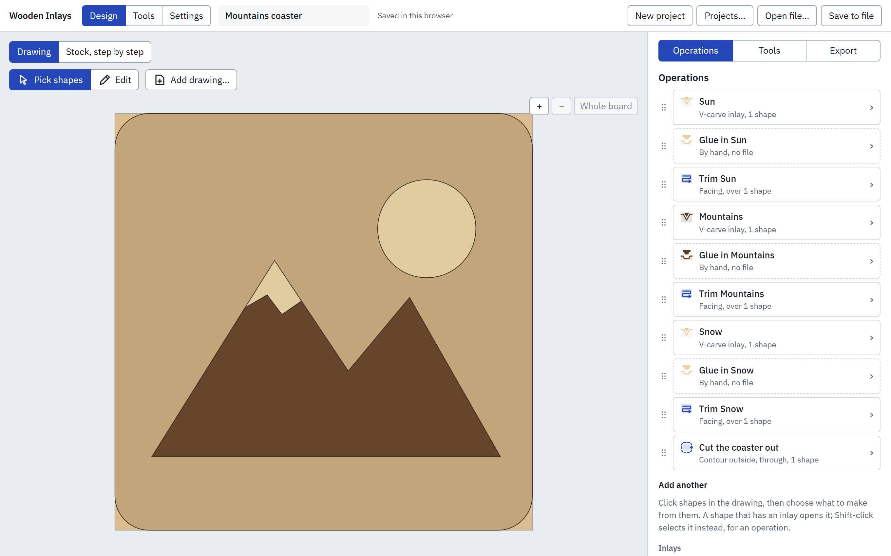
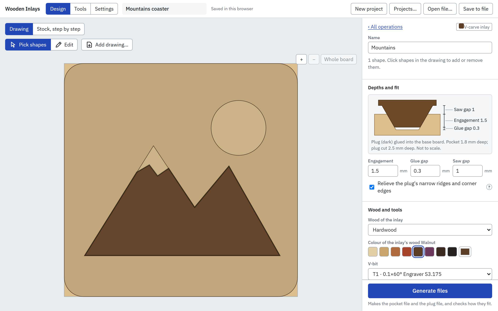
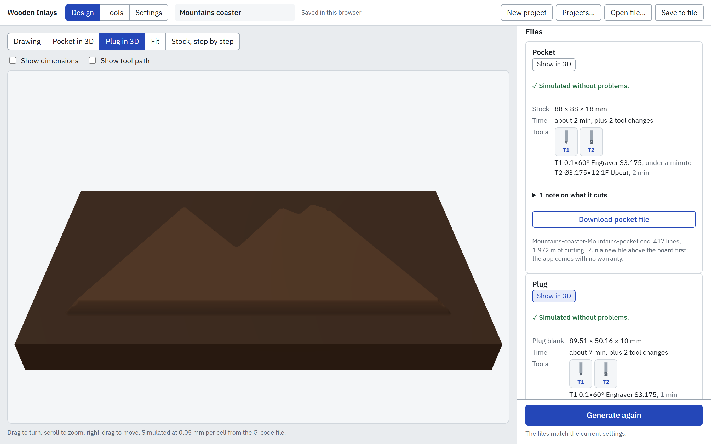
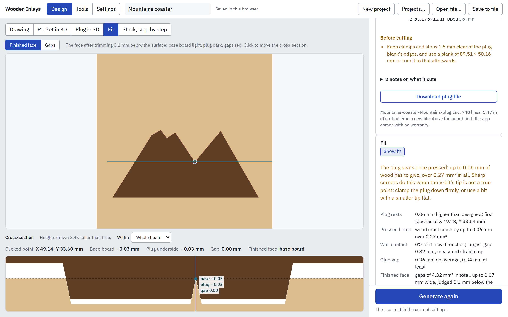
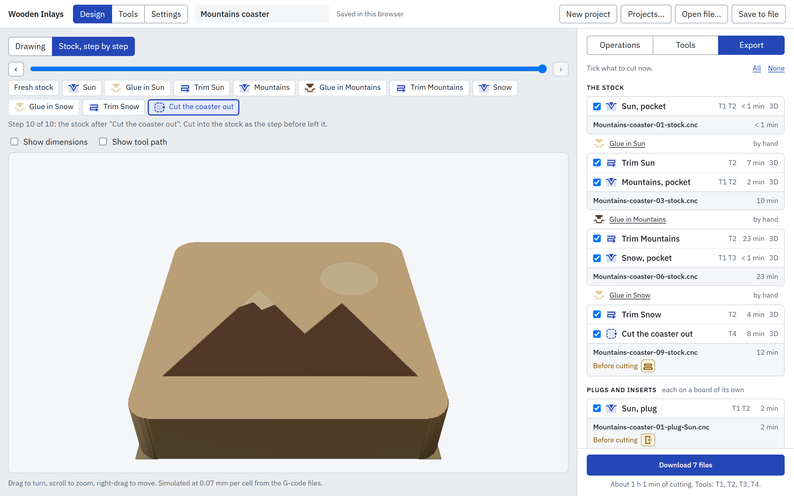
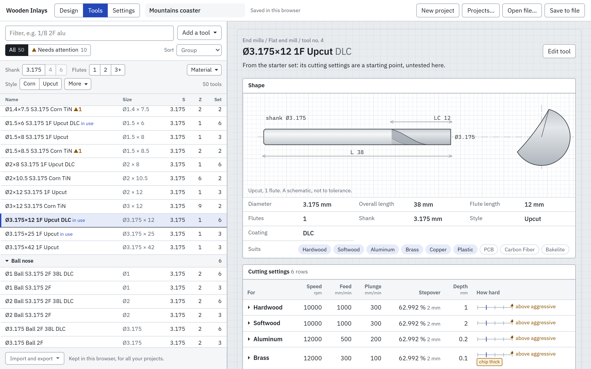

# inlay-cam

[](https://github.com/grappeq/inlay-cam/actions/workflows/ci.yml)

A web app that turns drawings into the two G-code files of a wooden inlay: one cuts the
pocket into the stock, the other cuts the piece that fills it. It also cuts plain pockets,
contours and chamfers, and faces the stock. It simulates every file and reports how an
inlay's two parts will fit before any wood is cut.



- **V-carve inlays**, with sloped walls and sharp corners, and **flat inlays**, with
  upright walls, as loose pieces or as one plug.
- Reads **SVG and DXF** drawings; simple shapes can be drawn, and shapes moved, resized, turned and deleted, in the
  app.
- Writes G-code for a **Carvera Air running the
  [Carvera Community Firmware](https://github.com/Carvera-Community/Carvera_Community_Firmware)**.
  No other controller is supported yet.
- Cuts with **your own tool list**: each bit runs the speeds and feeds it has for the
  stock's material, on the profile chosen for it, and an operation can change any of the
  numbers for itself.
- The simulation runs on the text of the G-code file itself, and the **fit check** lowers
  the simulated plug into the simulated pocket.
- Everything runs in the browser. It needs no server: drawings, projects and tools stay
  on your computer.
- It can be [served with one](#with-a-server), which keeps tools, projects and settings on
  the server for every browser that opens it, with an HTTP API for scripts and agents.
- An AI agent such as Claude Code can [work in the page open in your browser](mcp/README.md):
  it draws, sets up inlays, builds and exports through the app, in front of you.

Try it at <https://grappeq.github.io/inlay-cam/>, and read the
[user guide](docs/guide.md).

## Screenshots

A coaster with a walnut mountain range, a maple sun and a maple snow cap, as V-carve
inlays in an 88 mm blank. The drawing is one small SVG.

| | |
|---|---|
|  An inlay: how deep the plug sits, its wood and its bits. |  The plug, simulated from its own G-code file. |
|  The fit check lowers the simulated plug into the simulated pocket. |  The stock after every step of the list, and the files to cut it. |



## Status and safety

The app has been used to machine a few jobs on a Carvera Air, with success. It is still
**very much experimental**: that is a handful of cuts, on one machine, with one person's
tools and woods, and much of what the app can do has been checked in simulation only. An
air cut confirmed that the firmware reads its G-code as intended (see
[machine-tests](machine-tests/README.md)). Expect rough edges, and treat every file as
untested until you have watched it run.

G-code moves a spinning tool. The simulation checks a file against the board and tools you
described, not against your machine as it stands: it cannot see clamps, a wrong work
origin or a tool that differs from its entry in the tool list. Check every file, run it
above the board first, and keep a hand near the stop button. The app comes with no
warranty (see [LICENSE](LICENSE)); what a file does on your machine is your
responsibility.

## Layout

| Path | What |
|---|---|
| `crates/inlay-core` | Rust core: geometry, data model, file formats, SVG and DXF import, toolpaths, G-code, simulation and fit check |
| `crates/inlay-wasm` | WebAssembly wrapper around the core |
| `crates/inlay-server` | Optional server: the built app, with tools, projects and settings kept in one data folder and an [HTTP API](docs/api.md) over them |
| `web` | TypeScript + React UI; runs the core in a Web Worker |
| `mcp` | [inlay-cam-mcp](mcp/README.md): the local server an AI agent starts to drive the open page. Node.js, no dependencies; the `package.json` at the root is its own, so that `npx` can run it from GitHub |
| `machine-tests` | G-code files to run on the real machine, with checklists |
| `docs` | [User guide](docs/guide.md) and [file formats](docs/formats.md); [how the server works](docs/server.md) and its [API](docs/api.md); what is still to do is in the [roadmap](docs/roadmap.md); `docs/design` holds the original [requirements](docs/design/requirements.md) and the [build plan](docs/design/plan.md), with what was done and why |
| `tools` | The script that writes the test drawings |

## Building

Needs Rust (with the `wasm32-unknown-unknown` target), `wasm-pack` and Node.

```bash
rustup target add wasm32-unknown-unknown
cargo install wasm-pack --locked
cd web && npm install
```

```bash
cargo test --workspace          # core tests
cd web && npm run wasm          # build the core to WebAssembly into web/src/wasm
cd web && npm test              # tests of the web app's own logic
cd web && npm run dev           # dev server on http://localhost:5173
cd web && npm run build         # type-check and build static files into web/dist
```

`npm run wasm` must be run once before `dev` or `build`, and again after changing Rust
code. The built app in `web/dist` is static files that work from any folder on any web
host.

## With a server

On a static host everything is kept in the browser. Served by `inlay-server`, the same
build keeps everything on the server instead, shared by every browser that opens the page:
the tool list, projects, the machine, the inlay defaults and what the screens remember. It
is one or the other; nothing is kept in the browser while there is a server.

```bash
docker compose up --build -d      # then open http://localhost:8000
```

or, without Docker, after `npm run build` in `web`:

```bash
cargo run --release -p inlay-server -- --web web/dist --data data
```

Every commit on main is also published as an image by `.github/workflows/image.yml`:
`ghcr.io/grappeq/inlay-cam:main` is the newest, `:sha-<commit>` one in particular. To run
that instead of building, put it in `compose.yaml` as the `image:` and take out `build: .`.

- The tool list is `tools.json` in the data folder (the volume `inlay-data`, `/data` in the
  container): a tool file as "Export a tool file" writes it. A new folder starts with an
  empty list; add the starter set or import your own in the app.
- Projects are project files in `projects/`, one per project, in the folders you file
  them in under the Projects tab, and the rest is `settings.json`. A project deleted in the app is moved to `backups/`, not destroyed.
  Projects from a browser come over as files: "Save to file" there, "Open file…" here.
- Before each change to the tool list the file as it was is kept in `backups/` beside it: the newest 30,
  and of older ones the last of each day, for 60 days.
- A page that is open looks for changes to the tool list when it is come back to, and once a
  minute. When two change the list at the same moment, the second is refused, reads the
  list again and makes its change over it, so both are kept; only a value changed in both
  places is decided, for the server's, and the page names it. A project saved from another
  window or browser while it was changed here is not written over: the page asks whether to
  keep both, use the other or keep its own. When the server cannot be reached, the top of
  the page says so, and the changes wait there until it answers.
- [docs/server.md](docs/server.md) shows how the server works, with pictures.
  [docs/api.md](docs/api.md) describes the API, and
  [docs/agent-brief.md](docs/agent-brief.md) is a brief to paste into an agent so that it
  reads your tools and their speeds and feeds from the server and logs your runs.

There is no login. The port is published on this machine only; to serve it on your network,
publish it on all interfaces and let it answer any host name:

```bash
INLAY_BIND=0.0.0.0 INLAY_ANY_HOST=1 docker compose up -d
```

(`--host 0.0.0.0 --any-host` without Docker.) Then anyone who can reach the port can read
and change everything kept there, so limit who can with a firewall or a proxy that asks for a login,
and know what that leaves:

- By default the server only answers as `localhost`, which stops DNS rebinding. With any
  host answered, a malicious web page opened in a browser that can reach the server can read
  and change the tool list, and an address filter does not stop that. Use it on a network
  you trust; DNS rebind protection in your resolver or router blocks the attack.
- Docker's published ports bypass host firewalls such as ufw: filter in the `DOCKER-USER`
  chain or on a network firewall.
- Traffic is plain HTTP; put an HTTPS reverse proxy in front on a shared network.

While working on the app, `INLAY_SERVER=http://localhost:8000 npm run dev` makes the dev
server pass `/api` on to a running `inlay-server`.

## Contributing

Issues and pull requests are welcome, most of all reports from real cuts and drawings
that import wrongly (attach the file). Run `cargo test --workspace` and, in `web`,
`npm test` and `npm run build` before sending a change.

## Licence

[MIT](LICENSE). The interface uses IBM Plex Sans, under the SIL Open Font License.
