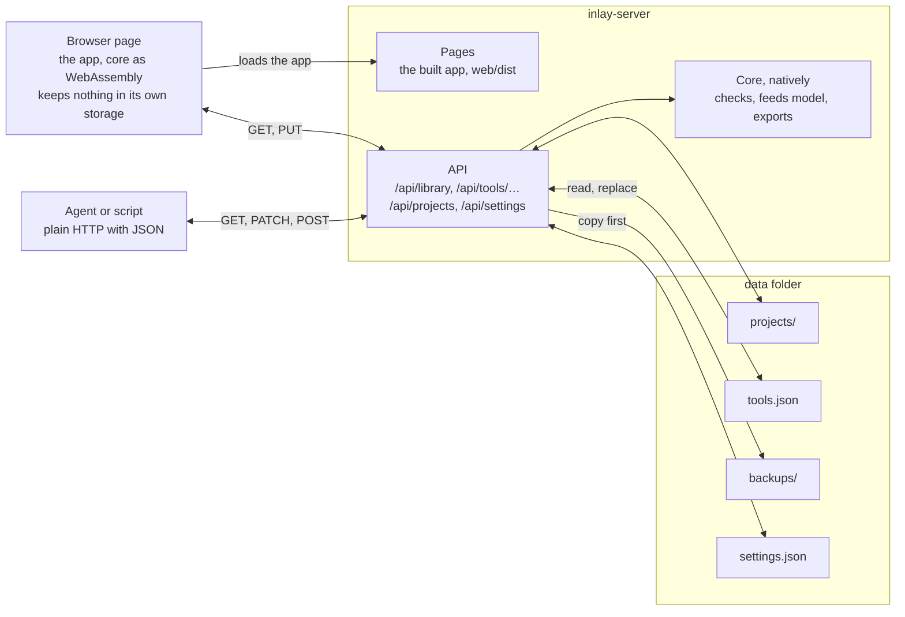
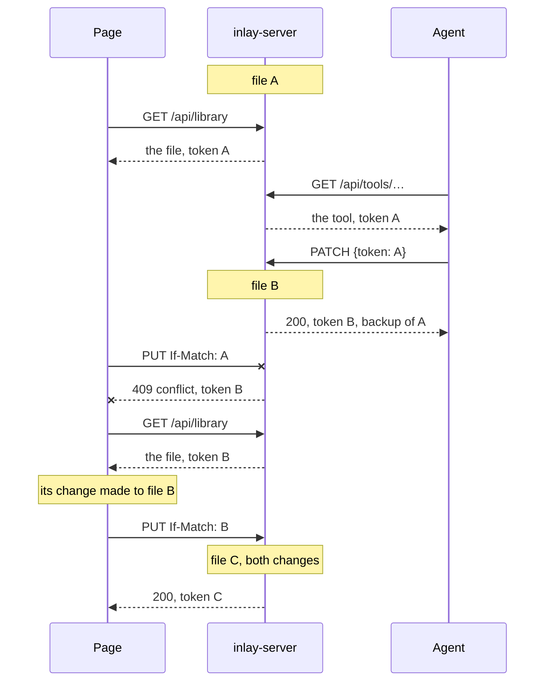

# How the server works

`inlay-server` is one small program that serves the app and keeps everything the app would
otherwise keep in a browser. The tool list is one file that browsers and agents change
through the same API, and a token decides whose change is written.

Setting it up is in the [README](../README.md#with-a-server); every route is in
[api.md](api.md). The code is `crates/inlay-server`.

## The parts

The page and an agent are equal clients of one API. The server runs the same core the page
runs as WebAssembly, so a tool is checked, and a library for another program written, by
one piece of code.

The page asks `api/health` when it starts. Served by `inlay-server`, it keeps everything on
the server: the tool list, projects, the machine, the inlay defaults, even the sort order
of the tool list. On a plain web host the question gets a 404, and everything stays in the
browser. It is one or the other, never some of each (`web/src/storage/home.ts`).

| In the data folder | What | In a browser instead |
|---|---|---|
| `tools.json` | Tools, their cutting rows and logs, materials, profiles, groups: a [tool file](formats.md#tool-library-kind-tool-library) | IndexedDB |
| `projects/<id>.json` | One [project file](formats.md#project-kind-project) per project | IndexedDB |
| `settings.json` | The machine, the inlay defaults, the last open project, what the screens remember | IndexedDB and local storage |
| `backups/` | The tool file before each change, and deleted projects | (none) |

## What happens to a write to the tool list

Every write to the tool list, the page's whole-file `PUT` and an agent's one-tool `PATCH`
alike, goes through the same steps under one lock (`Api::write` in `api.rs`).

| | Step | Ends here with |
|---|---|---|
| 1 | **Check who is asking.** The `Host` must be this machine, and the request must carry `X-Inlay: 1`, which a page of another site cannot send. | `403` |
| 2 | **Read `tools.json` and take its token**, the SHA-256 of the file's bytes. | `422 load_error` |
| 3 | **Compare the token the request names.** A different token means the file changed after the client read it. | `409 conflict` |
| 4 | **Make the change to the tool list.** A key the tool model does not have is refused, so a misspelt key never vanishes in silence. | `400`, `404` |
| 5 | **Check the whole list**, as the app checks an imported tool file. | `422 invalid` |
| 6 | **A dry run stops here.** It answers what the write would, with the diff of the file if asked for. | `200`, `dryRun` |
| 7 | **Keep the file as it was in `backups/`.** A write that changes no byte keeps no backup and ends here. | `200`, `unchanged` |
| 8 | **Write a new file and rename it over the old.** A reader, or a snapshot of the folder, never sees half a file. | `200`, the new token |

## Two writers at once

The first write wins and the second is refused, so nothing is ever written over a version
its writer has not seen. The page then puts the two changes together
(`web/src/state/merge.ts`): it reads the server's list, makes to it what was changed here
since the version it last held, and writes that, over the server's new token. Tools,
materials, profiles and groups are told apart by their ids and keys, and so are a tool's
cutting rows, so a change here to one tool and one there to another are both kept, as are
two changes to different fields or rows of one tool, and cuts logged in both places. Where
both changed the same value, the server's is kept, and the page names what it was in:
"the tool … was changed in both places, and the change made there was kept."

To make a refusal rare, an open page asks for a newer list when it is come back to and once
a minute, sending the token it holds; the server answers `304` when nothing changed.

## A project open in two places

A project is one person's work, but it may be open in two windows, or on two computers.
The page keeps each project as it last read or wrote it. When it saves, and what is kept
is neither that nor what the page has now, the project was saved from somewhere else in
the meantime, and the page stops saving it and asks: keep both (its own version becomes a
copy under Projects, and the other is shown), use the other, or keep its own. On a server
the save names the version it is made over (`If-Match`), so two saves at the same moment
are told apart as well. The same is looked for when the page is come back to and once a
minute: a project that was not changed here is simply shown as it was saved there, and
says so.

This works in a browser without a server too, between two tabs. Settings are not checked:
the last write is kept.

## When the server is out of reach

Every request to the server notes whether it answered (`web/src/storage/server.ts`): a
request that gets no answer, or a proxy's 502, 503 or 504, puts the page out of reach. The
top of the page then says "Server out of reach: changes wait here" in place of where things
are saved, the errors of each failed save are not shown one by one, and closing the page
asks first. The server is asked again every few seconds, then less often, up to every 30
seconds; when it answers, what waits is saved: the project, the tool list, the machine and
the inlay defaults. The browser's own word that it went offline or online is taken as a
hint.

A page finds out at its next request: a save, the look for a newer tool list once a minute,
or coming back to the page.

## Backups

- **Before every change to the tool list**, the file as it was, named by the time:
  `tools-20261118-091203-000.json`.
- **The newest 30 are all kept.** The page saves on every edit, so recent history is whole.
- **Older ones thin to one a day, for 60 days**: the last backup of each day stays.
- **A deleted project** is moved here, as `project-<date>-<time>-<ms>-<id>.json`, and stays.

Putting a tool file back needs no route of its own: `GET /api/backups/<name>`, then `PUT`
its text to `/api/library`. The file it replaces is backed up in turn.

## The routes, in short

| For | Route | What it does |
|---|---|---|
| The page | `GET, PUT /api/library` | The whole tool file, read and replaced |
| Finding | `GET /api/tools?q=&material=` | A compact list, searched by words |
| One tool | `GET, PATCH, DELETE /api/tools/<tool>` | Read it, change what a patch names, delete it |
| The other lists | `GET, POST /api/materials`, `GET, PATCH, DELETE /api/materials/<key>`; the same for `profiles` and `groups` | One material, profile or group at a time |
| A new tool | `POST /api/tools` | Added after the last tool of its group |
| A cut | `POST /api/tools/<tool>/rows/<row>/log` | A dated result, kept with the row's numbers |
| Feeds model | `GET /api/tools/<tool>/suggestions` | Computed numbers for a row |
| Overview | `GET /api/attention` | Failed and unconfirmed rows, things to check |
| Other programs | `GET /api/export/<kind>` | Makera CAM, Makera Studio, Fusion 360, `tools.yaml`, made on the spot |
| History | `GET /api/backups` | The backups kept, and each as a file |
| Projects | `GET, PUT, DELETE /api/projects/<id>` | One project file each; `If-Match` on a `PUT` |
| Settings | `GET /api/settings`, `PUT /api/settings/<key>` | One text per key |

Every write to the tool list takes `dryRun` and `diff`, so an agent can show the exact
change to the file before it is made. The details of each are in [api.md](api.md).
